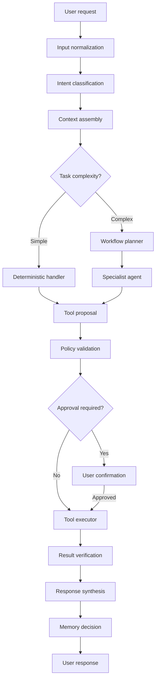

# Core orchestrator

[Documentation index](../README.md)

> Target architecture derived from Project PT specification v3.0, November 2026. These are planned capabilities unless explicitly stated otherwise.

The orchestrator manages requests from initial input through final response. It is responsible for selecting workflows, delegating work, tracking state, and determining whether the requested operation succeeded.

The orchestrator manages workflow execution and calls the LLM when needed.

### Processing workflow

The orchestrator has seven main responsibilities.

| Component         | Function                                             |
| ----------------- | ---------------------------------------------------- |
| Intent classifier | Identify what the user wants                         |
| Context builder   | Retrieve relevant conversation, memories, documents  |
| Task planner      | Decompose complicated requests into steps            |
| Agent router      | Select Academic, Personal, or Trading workflows      |
| Tool coordinator  | Request and sequence allowed tool operations         |
| State manager     | Preserve workflow progress, errors, and dependencies |
| Result verifier   | Check execution status before reporting success      |

### Deterministic vs agentic execution

Not every request requires an LLM.

Simple command: "Hey PT, open VS Code."

A deterministic intent handler recognises the command, checks permission, calls a verified application-launch function, and reports the result. The LLM may not need to participate.

Complex request: "Hey PT, review my Data Science lectures and generate a revision PDF concentrating on topics I struggled with."

This requires document retrieval, contextual memory, planning, summarization, PDF generation, validation, and file delivery.The design uses LangGraph for complex workflows, with support for explicit workflow state, checkpoints, errors, and human approval stages.
