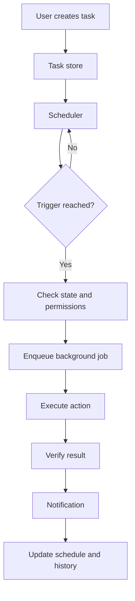

# Scheduling and proactive intelligence

[Documentation index](../README.md)

> Target architecture derived from Project PT specification v3.0, November 2026. These are planned capabilities unless explicitly stated otherwise.

PT should eventually do more than respond to commands. It should also manage explicitly authorised reminders and scheduled tasks.

Example:

"PT, remind me three days before my Data Science assessment."

The scheduler saves the event, calculates the trigger using the configured timezone, and dispatches a notification when due.

It must account for Windows sleep, restarts, missed executions, duplicate triggers, daylight-saving changes, and tasks that become invalid because an assessment date changes.

The initial scheduler uses deterministic execution. Agent-based review of scheduled tasks is a possible later extension.
